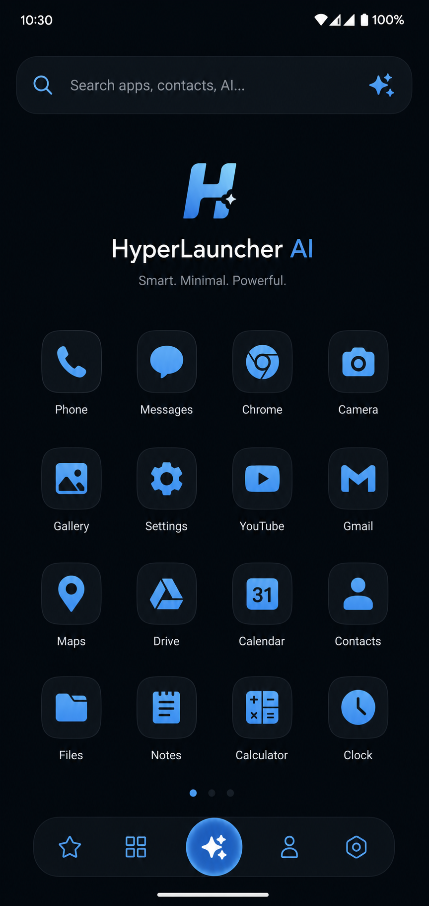
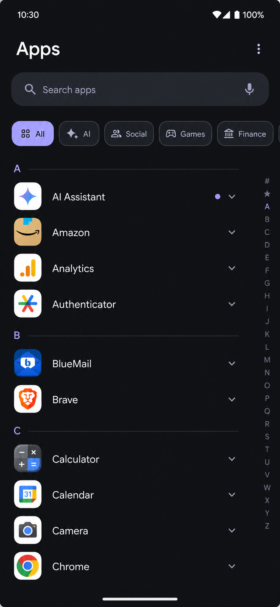
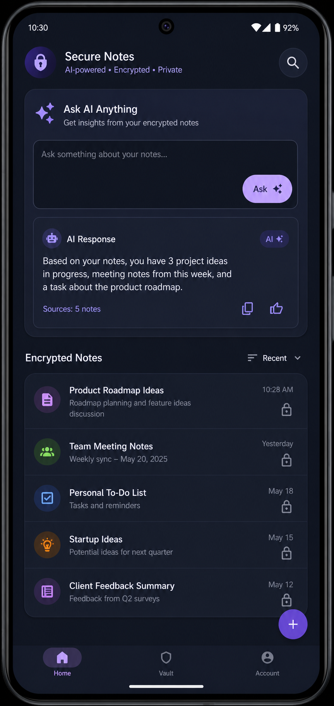
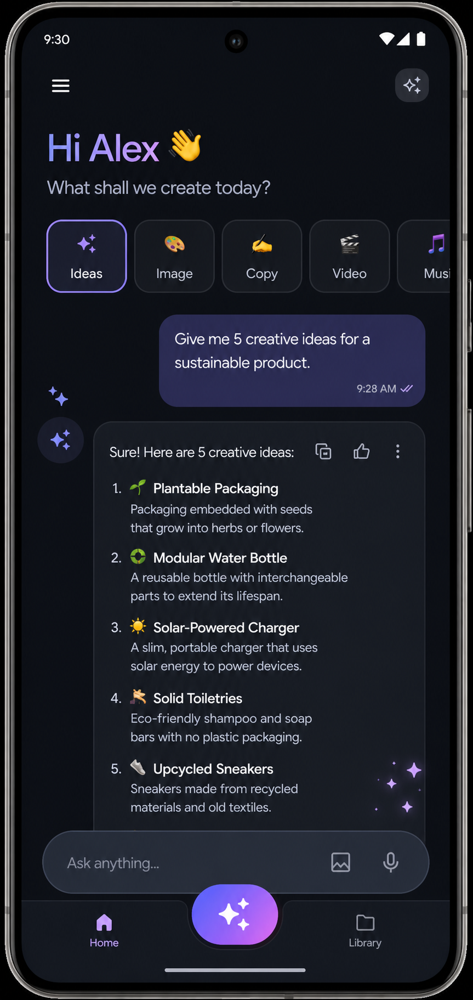

# HyperLauncher AI

Offline-first Android launcher for **Redmi 12 4G** (8GB / 256GB / Helio G88 / 90Hz FHD+),
HyperOS 2 / Android 14 (API 34). Min SDK 28, target/compile SDK 34.

**Offline by default. No telemetry. No background sync. No wake-locks. No polling.**

## Visual concepts & creative ideas

Explore [four app design concepts and proposed features](docs/DESIGN_IDEAS.md),
covering the launcher home, categorized drawer, prompt-to-vault workflow, and
creative assistant. These are **AI-generated mockups, not running-app screenshots**.

| Launcher home | Categorized app drawer |
|:---:|:---:|
|  |  |

| AI prompt & encrypted vault | Creative AI assistant |
|:---:|:---:|
|  |  |

## Flavors (one tree, two APKs)

| Flavor | INTERNET permission | Network code | Use |
|---|---|---|---|
| `offline` (default) | **No** | Excluded at compile time | Fully offline launcher + vault + categorization |
| `network` | Yes | OpenRouter Creative Layer only | Adds opt-in cloud AI via OpenRouter |

The offline APK is verified in CI to declare **no** `INTERNET` permission.
The network APK's only network path is a locked-down OkHttp client that
resolves **only** `api.openrouter.ai` (DNS + interceptor firewall,
certificate-pinned, cleartext disabled).

## Features

- **Core launcher**: single-activity Compose / Material 3, MVVM + Repository,
  manual DI (no Hilt), Room for apps/categories/prompt-logs/cache.
- **Smart categorization**: 13 mandatory categories via `categories.json`
  heuristics (package match → keyword match → Others). Fully local.
- **AI prompt bar**: offline build explains AI is unavailable; network build
  calls OpenRouter only when you enable it and save your key.
- **AI Notes vault**: SQLCipher AES-256 encrypted vault with passphrase.
  Key material in EncryptedSharedPreferences (AES-256-GCM). Vault DB excluded
  from cloud backup.
- **Accessibility capture**: whitelist-only, master toggle **OFF by default**,
  disclosure before redirect to Accessibility Settings. Captures only
  whitelisted apps, only when vault is unlocked.
- **OpenRouter Creative Layer** (network flavor): user-keyed, user-enabled,
  `ConnectivityManager.setProcessDefaultNetwork(null)` at launch so only the
  locked-down client can reach the network. Key never logged/committed.

## Performance gates

- APK < 25 MB (hard 30 MB) — enforced in CI.
- Cold start < 350 ms (hard 500 ms).
- 60 fps drawer scroll with 120+ apps (LazyColumn, keyed items).
- Idle RAM ≤ 80 MB.
- Search debounce 12 ms (< 16 ms gate).
- 0 wake-locks / 0 polling.

## Build

Requires JDK 21 + Android SDK. All compilation runs in GitHub Actions CI
(sandbox has no JDK/SDK — see `DEBUG_LOG.md`).

```bash
./gradlew :app:assembleOfflineDebug
./gradlew :app:assembleNetworkDebug
./gradlew :app:testOfflineDebugUnitTest
```

## Release

`release.yml` requires all four Actions secrets: `KEYSTORE_BASE64`,
`KEYSTORE_PASSWORD`, `KEY_ALIAS`, and `KEY_PASSWORD`. Signing files are ignored
by Git and removed from the runner after the job. Missing or invalid signing
credentials fail the release; there is no unsigned fallback.

Pushes to `main` build verified signed artifacts. Version tags publish releases;
**Actions → Release → Run workflow** publishes the signing-fix release `v1.0.1`.
Before distribution, both APKs must pass `apksigner` verification against the
keystore certificate, alignment, permission and size checks, and installation
on an Android 14 emulator. This is not physical Redmi or app-runtime validation.
`OPENROUTER_API_KEY` is **never** a CI secret.

The old `v1.0.0` files ending in `-unsigned.apk` are not installable. Download
`HyperLauncherAI-offline-release.apk` or `HyperLauncherAI-network-release.apk`
from a verified signed release instead. Keep the original signing key securely:
future updates must use the same key.

## Setup (Redmi 12 4G)

1. Install `HyperLauncherAI-offline-release.apk` (or `-network-` for AI).
2. Set as default launcher: Settings → Apps → Default apps → Home app.
3. Grant `QUERY_ALL_PACKAGES` (auto-granted for launchers; needed to list apps).
4. (Optional) Enable Accessibility capture in HyperLauncher Settings →
   disclosure → Accessibility Settings. Add whitelisted apps.
5. (Network build only) Settings → Network & AI → enable OpenRouter →
   paste `sk-or-v1-…` key → Save. Key is stored encrypted on-device only.

## Docs

- `DEBUG_LOG.md` — Phase 5 bug table + self-healing log.
- `KNOWN_LIMITATIONS.md` — known limits and impossibilities.
