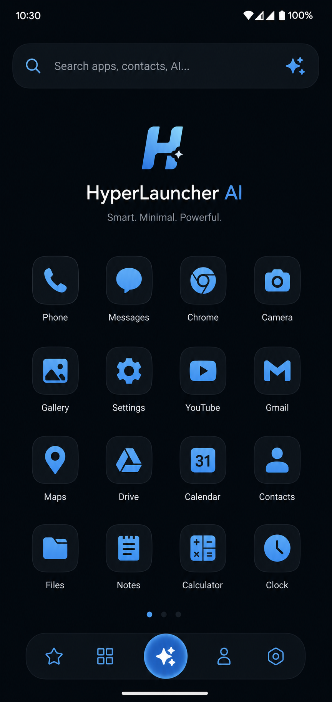
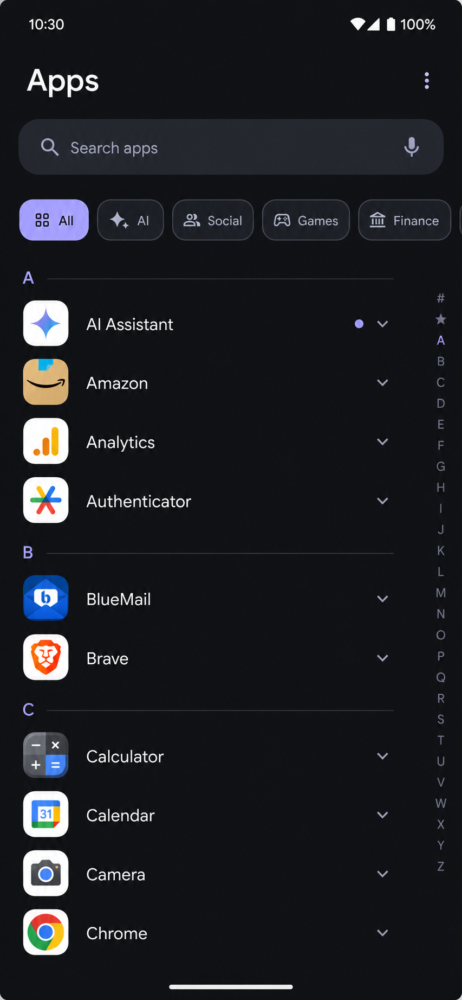
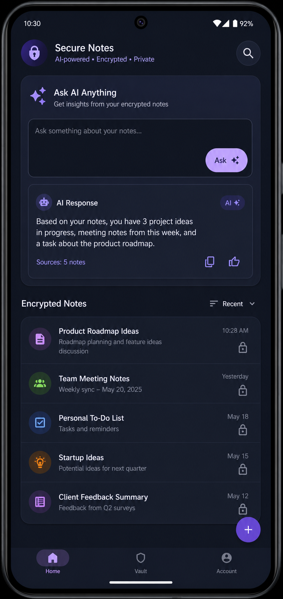
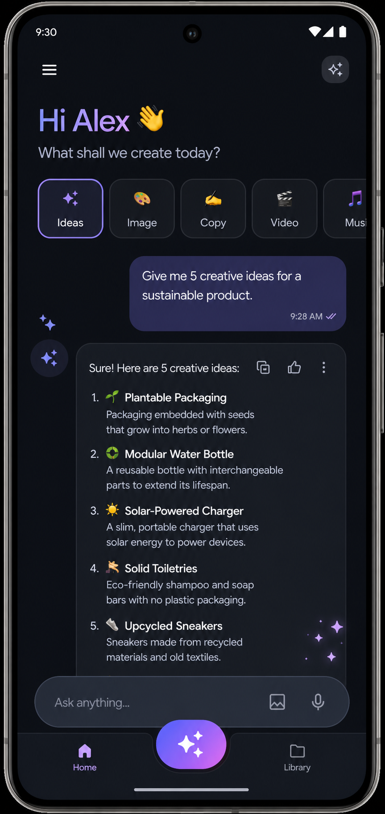

# HyperLauncher AI — visual concepts & creative ideas

These four AI-generated images are **design concepts, not screenshots of the running app**. Icons, text, layouts, and depicted features are illustrative; they do not establish implementation or device-test results.

## Concept gallery

### 1. Focused launcher home

**Direction:** a calm, dark home screen with a prominent search entry and frequently used apps within easy reach.

**Idea to explore:** a user-pinned “Focus shelf” containing four apps for a chosen activity (work, study, or travel). Store selections locally; never rearrange pinned apps automatically.

### 2. Category-first app discovery

**Direction:** category chips above a searchable app list, using the launcher's local categorization as the starting point.

**Idea to explore:** long-press an app to change its category and show a simple “Why this category?” explanation. Keep manual overrides on-device and provide an undo action.

### 3. Prompt-to-vault workflow

**Direction:** turn a useful response into an explicitly saved note, without making cloud access a prerequisite for the vault.

**Idea to explore:** a “Save as checklist” action with an editable preview. Require vault unlock before saving; never automatically upload vault contents as prompt context.

### 4. Creative assistant

**Direction:** an approachable creative workspace for brainstorming rather than an always-listening assistant.

**Idea to explore:** optional prompt starters such as “Brainstorm a weekend project,” “Outline a study plan,” and “Turn my idea into three next steps.” Show a clear network indicator and require an explicit submit action before any cloud request.

## Additional product ideas (proposals, not shipped features)

| Idea | User benefit | Privacy / implementation boundary |
|---|---|---|
| Offline quick actions | Launch calculator, camera, or a pinned note from search | Use local Android intents; gracefully handle missing apps |
| Vault idea garden | Group manually saved ideas by user-created tags | Operate only while unlocked; no cloud indexing |
| One-handed layout | Move search and category controls toward the bottom | User-selectable layout; test large fonts and TalkBack |
| Quiet mode presets | Hide selected app groups during a focus session | Local visibility preference, not an app-blocking or security guarantee |
| Creative remix cards | Request three alternative titles or action plans | Network flavor only; preview the exact text sent and exclude private notes by default |
| Transparent category editor | Correct app organization without retraining a model | Persist explicit overrides locally and offer reset/undo |

## Suggested next steps

1. Validate home and drawer layouts on Redmi 12 4G with large fonts, TalkBack, and one-handed use.
2. Prototype category overrides and offline quick actions before adding more network features.
3. Test prompt-to-vault flows with locked, unlocked, empty, and error states.
4. Measure startup time, scrolling, and memory on-device; these illustrations are not performance evidence.

## Asset inventory

- `images/01-launcher-home.png` — launcher home concept.
- `images/02-app-drawer-categories.png` — categorized app drawer concept.
- `images/03-ai-prompt-vault.png` — AI prompt and vault concept.
- `images/04-creative-ai.png` — creative assistant concept.

All four assets were AI-generated for this repository. They are intended for design exploration and should remain labeled as concepts wherever reused.
